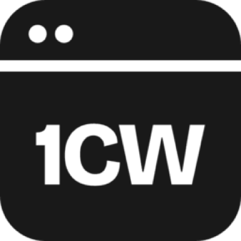

<p align="center"></p>

# 1ClickWebsite MCP Server

Official remote MCP server for [1ClickWebsite](https://www.1clickwebsite.ai), the AI WordPress website builder for agencies. Let Claude, ChatGPT, Cursor, Cline or any MCP client build and edit WordPress websites for local service businesses, and run Lead Gen demo-site batches.

- **Endpoint:** `https://www.1clickwebsite.ai/api/mcp` (Streamable HTTP)
- **Auth:** OAuth sign-in, or a 1ClickWebsite API key as a Bearer header ([get a key](https://www.1clickwebsite.ai/api-keys))
- **Docs:** https://www.1clickwebsite.ai/docs/mcp
- **MCP Registry:** `ai.1clickwebsite/mcp`

Nothing runs locally. This repo holds the setup docs and registry listing.

## What it can do

- Find a business on Google and build a complete WordPress site for it (copy, images, service and location pages) in minutes
- Check build status and list your sites
- Edit finished sites: pages, text, images, SEO, with one-step rollback
- Lead Gen: create batches of personalized demo sites from a list of prospects, then export the links for outreach
- Check your credit balance before anything that costs credits

## Tools

| Tool | What it does |
|------|--------------|
| `find_business` | Look up a business on Google to build a site from |
| `create_site` | Build a full WordPress site from a Google place or details |
| `site_status` | Check a build and get the site link |
| `check_credits` | See your credit balance and costs |
| `list_templates`, `list_sites` | Browse designs and your sites |
| `list_lead_gen_templates`, `create_lead_gen_batch`, `list_lead_gen_batches`, `get_lead_gen_batch`, `update_lead_gen_batch`, `update_lead_gen_site`, `export_lead_gen_batch` | Lead Gen demo-site batches |
| `site_guide` | Rules for editing a given site |
| `get_tools`, `run_read_tool`, `run_change_tool` | Grouped site-editing tools (pages, content, SEO, rollback) |

## Setup

### Claude Code
```bash
claude mcp add --transport http 1cw https://www.1clickwebsite.ai/api/mcp \
  --header "Authorization: Bearer YOUR_1CW_API_KEY"
```

### Claude.ai / ChatGPT
Add a custom connector with the URL `https://www.1clickwebsite.ai/api/mcp` and sign in with your 1ClickWebsite account.

### Cursor, Cline, Windsurf and other clients
```json
{
  "mcpServers": {
    "1clickwebsite": {
      "url": "https://www.1clickwebsite.ai/api/mcp",
      "headers": { "Authorization": "Bearer YOUR_1CW_API_KEY" }
    }
  }
}
```

## Example prompts

- "Build a website for Smith Plumbing in Austin, TX."
- "Add a financing page to my roofing site and link it in the menu."
- "Make a Lead Gen batch for these 20 HVAC companies and give me the demo links."

## Pricing

Uses your 1ClickWebsite plan's credits. Plans start at $49/mo. See [pricing](https://www.1clickwebsite.ai/#pricing).

## Support

Support via https://www.1clickwebsite.ai or contact@boldslate.com.
